# Revenue Optimization & Customer Behavior Analytics using R

## Overview
This project analyzes two years of transactional e-commerce data end to end. It goes from **descriptive** statistics, through **inferential and predictive** models, to **prescriptive optimization** that turns the analysis into operating decisions.

- **Describe:** revenue KPIs, order-value distributions, top countries, products and customers
- **Infer and predict:** confidence intervals, hypothesis tests, linear and logistic regression, ANOVA, and time-series forecasting with seasonal indices
- **Prescribe:** an integer program for minimum-cost warehouse staffing, and a mixed-integer facility-location model for a European fulfillment hub

---

## Dataset
The project uses the **Online Retail II dataset** (https://archive.ics.uci.edu/dataset/502/online+retail+ii) from the UCI Machine Learning Repository.

Dataset characteristics:

• ~1 million transaction lines (both workbook sheets, combined and de-duplicated)  
• UK-based online wholesale retailer  
• Customers in 40+ countries  
• Transaction period: 1 Dec 2009 – 9 Dec 2011  

After cleaning (cancellations, missing customer IDs and non-positive quantities/prices removed): **36,969 orders from 5,878 customers, $17.4M revenue.**

Key variables:

| Variable    | Description                |
| ----------- | -------------------------- |
| Invoice     | Transaction identifier     |
| StockCode   | Product identifier         |
| Description | Product name               |
| Quantity    | Number of units purchased  |
| InvoiceDate | Transaction timestamp      |
| Price       | Unit price                 |
| CustomerID  | Unique customer identifier |
| Country     | Customer location          |

---

## Business Questions

1. What are the key revenue and customer activity metrics?
2. What is the expected average order value, and how precise is that estimate?
3. Do customers in different regions buy differently?
4. What factors influence order value?
5. What characteristics are associated with repeat purchasing customers?
6. How seasonal is revenue, and what should we expect in 2012?
7. How should the warehouse be staffed hour by hour to handle peak season at minimum cost?
8. Is a continental European fulfillment hub worth opening, and where?

---

## Analytical Workflow

### 1. Data Cleaning & Feature Engineering
- Combined both workbook sheets; the overlapping 1–9 Dec 2010 window is taken from one sheet only
- Removed cancelled transactions and rows without a customer ID
- Created revenue, month and customer-level features

### 2. Exploratory Data Analysis
- Monthly revenue trends
- Order value distribution
- Top countries, products and customers by revenue

### 3. Confidence Interval Estimation
Estimated the true average order value with a 95% confidence interval.

### 4. Hypothesis Testing
Welch two-sample t-test comparing UK and international order values.

### 5. Regression Analysis
Multiple linear regression of order value on basket size, average price and country.

### 6. Logistic Regression
Modeled the probability that a customer becomes a repeat buyer from first-order value, time since first purchase and product variety.

### 7. ANOVA
Tested whether order value differs across the major customer countries.

### 8. Time Series Forecasting
- Linear trend regression on 24 complete months
- Durbin-Watson test for autocorrelated residuals
- Seasonal indices (ratio-to-trend method)
- Seasonally adjusted trend model, with a Dec 2011 – Dec 2012 forecast and 95% prediction intervals

### 9. Staffing Optimization (Integer Linear Program)
- Built hourly pick/pack workload from the 90th percentile of order lines per hour, for a typical month and for the November peak
- Decision variables: number of full-time (8h) and part-time (4h) associates starting each hour
- Constraints: cover the required associates every hour; part-timers on duty never exceed full-timers
- Compared full-time-only against mixed staffing, with a sensitivity analysis on associate productivity

### 10. Network Optimization (Mixed-Integer Facility Location)
- Annual unit demand for 23 European countries, located at their capital cities
- Candidate hubs: London (existing), Amsterdam, Brussels, Paris and Berlin
- Binary decisions: which hubs to open and which hub serves each country (single sourcing)
- Objective: minimize annual fixed hub cost plus distance-based shipping cost
- Scanned the hub's annual fixed cost from $0 to $300K to find the break-even point

---

## Key Insights

**Descriptive and inferential**
- Average order value is **$472 (95% CI $458–$485)** across 36,969 orders.
- International orders are much larger than UK orders: **$871 vs $431 on average**, a difference of **$377–$504** (95% CI; Welch t = 13.6, p < 0.001). International buyers are fewer but behave like bulk wholesale customers.
- Order value differs significantly across the five largest markets (**ANOVA F = 161.4, p < 0.001**).

**Predictive**
- **Product variety is the strongest repeat-purchase signal:** each extra distinct product in a customer's history raises the odds of repeat purchase by about **5%** (odds ratio 1.05). Each extra 30 days of tenure raises the odds by about 6%.
- Revenue is strongly seasonal: **November runs 54% above an average month** (index 1.54), September–November together run 20–54% above, and February is the low point (0.73).
- A linear trend alone explains only 13% of monthly variation and leaves strongly autocorrelated residuals (Durbin-Watson 0.85). Adding seasonal indices raises in-sample R² to **0.95** and cuts error (MAPE) from **22% to 6.5%**.
- The forecast puts **November 2012 revenue at about $1.14M** (95% PI $0.92M–$1.37M).

**Prescriptive**
- Peak-season pick/pack needs up to **11 associates at midday but only 2 at opening**. A mixed schedule of **6 full-time and 8 part-time** associates covers every hour for **$1,312/day**. That is **$272/day (17%) less** than the best full-time-only schedule, and idle paid hours drop from 14 to 6.
- In a typical month the mixed schedule saves **$240/day (21%)**.
- Productivity drives cost: moving from 60 to 70 lines per associate-hour cuts peak daily cost by 11%, so pick-path or tooling improvements can be valued directly against labor.
- **Amsterdam is the best location for an EU hub.** It cuts annual European shipping cost from **$454K to $264K**, so the hub pays off only if it costs **less than ~$190K a year** to run.

---

## Limitations

- **Regression analysis (order value drivers):** `total_items` and `avg_price` are mathematical components of `order_value` itself, so part of the model's explanatory power reflects that arithmetic relationship rather than purely external drivers. Countries with fewer than 30 invoices were excluded to stabilize the estimates, but coefficients should still be read as descriptive rather than causal.
- **Logistic regression (repeat purchase prediction):** the dataset spans a fixed window (Dec 2009–Dec 2011). Customers whose first purchase fell near the end of this window had little remaining time to place a second order, which inflates the apparent effect of "time since first purchase." Customers with fewer than 90 days of observation time were excluded to reduce this bias, but the remaining effect should be read partly as an artifact of the observation window.
- **Time series:** only two seasonal cycles are available, and the seasonal indices are estimated from the same months they are evaluated on, so the R² and MAPE figures are in-sample and optimistic. Residuals of the adjusted model still show some autocorrelation (DW 1.26, p = 0.016).
- **Optimization inputs:** wages, associate productivity, freight cost per unit-km and the UK cross-border handling charge are stated assumptions, set at the top of each script. Demand points are approximated by capital cities. The models show the decision logic and break-even points; the dollar figures should be re-run with real cost data. The UK export charge is what moves Ireland to the Amsterdam hub.
- **No train/test split:** models are fit and evaluated on the full dataset, so predictive results reflect in-sample fit rather than out-of-sample generalization.
- **Associations, not causation:** all statistical findings are associations from observational data.

---

## Visualizations

### Monthly Revenue Trend
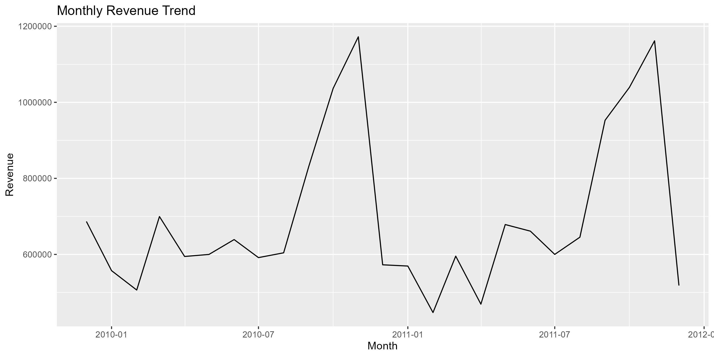

### Top 10 Countries by Revenue
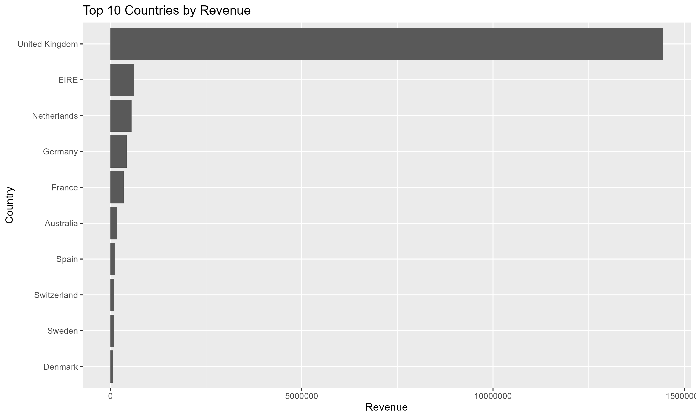

### Order Value Distribution
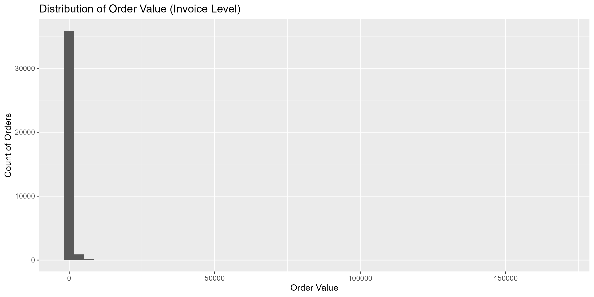

### UK vs Non-UK Order Value Comparison
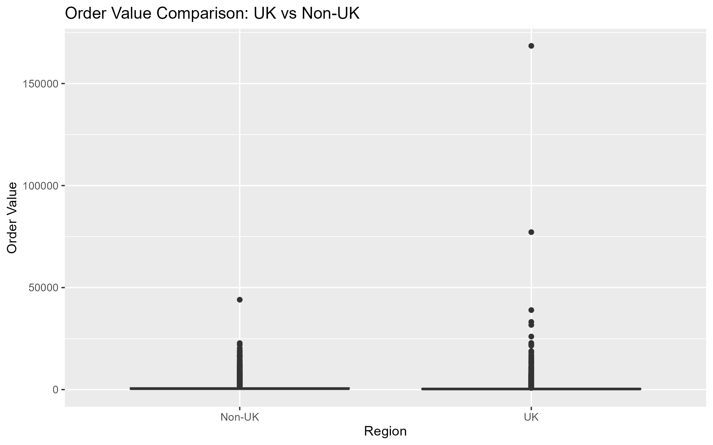

### Regression Diagnostics
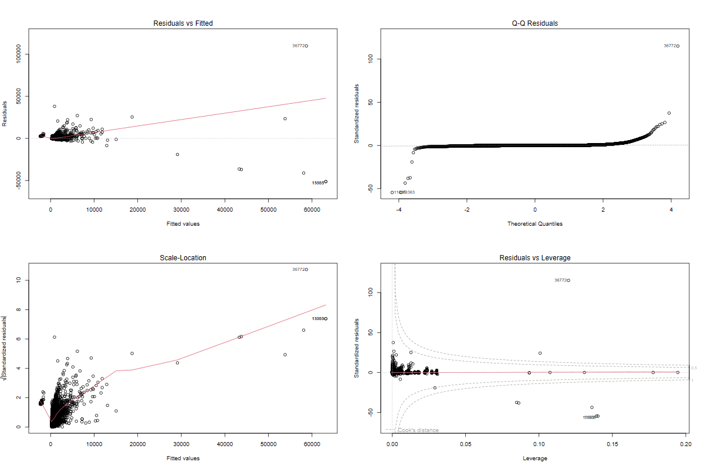

### Predicted Probability of Repeat Purchase
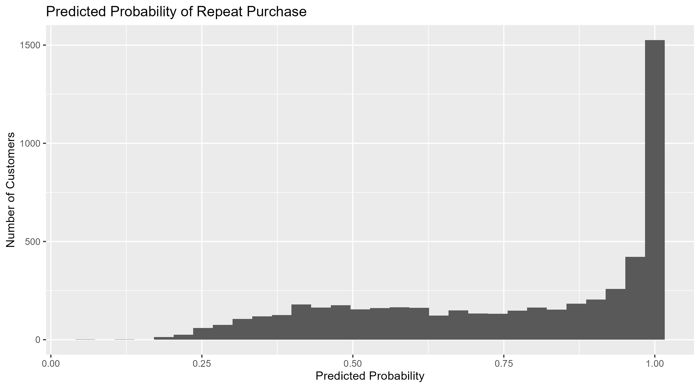

### Country Comparison (ANOVA)
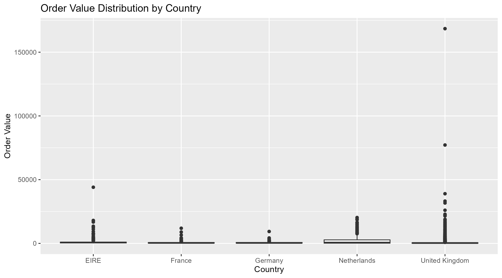

### Seasonal Indices
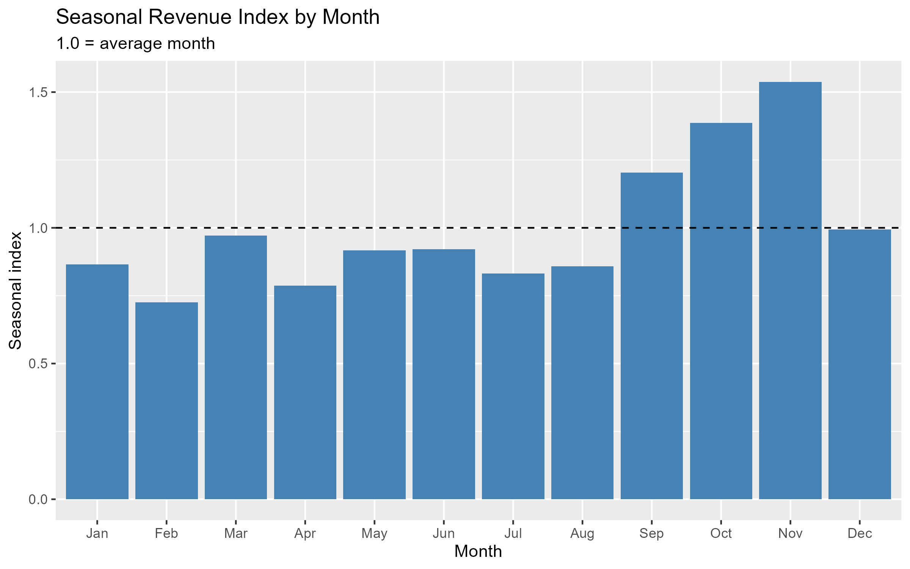

### Revenue Forecast
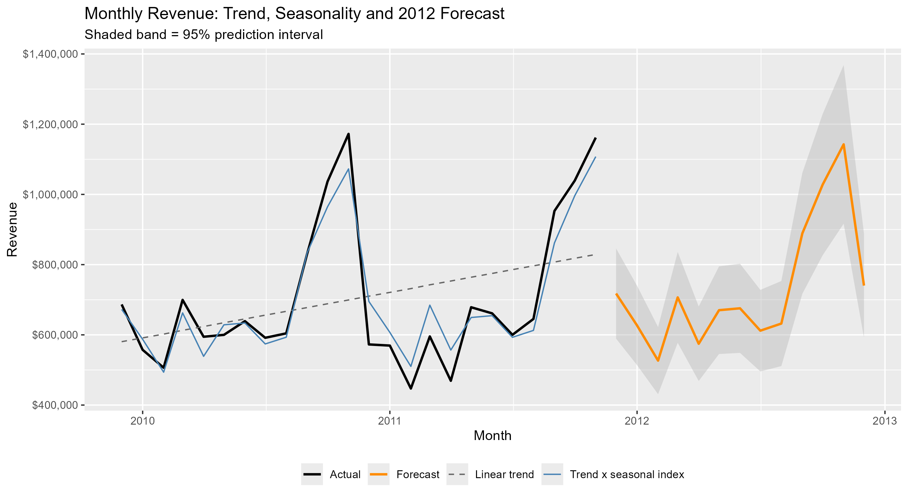

### Optimal Peak-Season Staffing Schedule
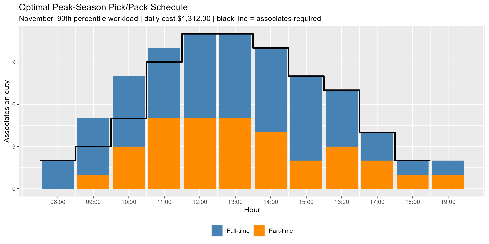

### European Hub Break-even
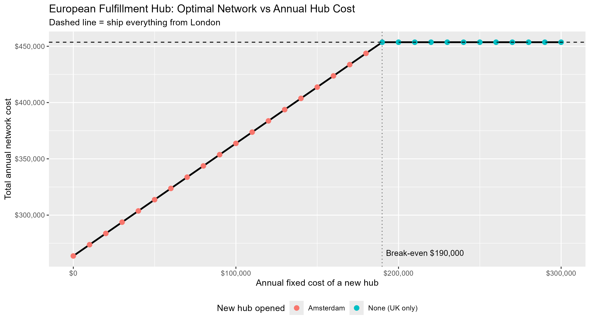

---

## Tools & Technologies

- R  
- tidyverse (dplyr, ggplot2, tidyr, stringr, purrr)  
- lubridate  
- broom  
- janitor  
- readxl  
- car  
- MASS  
- lmtest (Durbin-Watson test)  
- lpSolve (integer and mixed-integer programming)  
- scales  
- patchwork  
- here  
- Git  
- GitHub

---

## Project Structure
```
Revenue-Optimization-Analytics
│
├── data
│   ├── raw            # not tracked in git — download dataset here (see "How to Run")
│   └── processed       # not tracked in git — generated by 01_data_cleaning.R
│
├── scripts
│   ├── 00_setup.R
│   ├── 01_data_cleaning.R
│   ├── 02_eda_descriptive.R
│   ├── 03_confidence_intervals.R
│   ├── 04_hypothesis_testing.R
│   ├── 05_regression_analysis.R
│   ├── 06_logistic_regression.R
│   ├── 07_anova_analysis.R
│   ├── 08_time_series.R
│   ├── 09_staffing_optimization.R
│   └── 10_network_optimization.R
│
├── outputs
│   ├── tables
│   └── figures
│
├── business_problem.md
├── kpi_dictionary.md
└── README.md
```

---

## How to Run the Project

1. Clone the repository
git clone https://github.com/Onisha8/Revenue-Optimization-Analytics

2. Download the dataset
This repo does not include the raw dataset, to keep the repo lightweight.
Download the **Online Retail II** dataset from the UCI Machine Learning Repository:
https://archive.ics.uci.edu/dataset/502/online+retail+ii
Save it as `online_retail_II.xlsx` inside `data/raw/` (create the folder if it doesn't exist).

3. Install required R packages
install.packages(c("tidyverse","lubridate","broom","janitor","car","MASS","scales","patchwork","here","readxl","lmtest","lpSolve"))

4. Run scripts in order, from the `scripts/` folder:
scripts/01_data_cleaning.R  
scripts/02_eda_descriptive.R  
scripts/03_confidence_intervals.R  
scripts/04_hypothesis_testing.R  
scripts/05_regression_analysis.R  
scripts/06_logistic_regression.R  
scripts/07_anova_analysis.R  
scripts/08_time_series.R  
scripts/09_staffing_optimization.R  
scripts/10_network_optimization.R

Running script 01 regenerates `data/processed/retail_features.csv`, which all later scripts depend on. Optimization assumptions (wages, productivity, freight rates) are defined at the top of scripts 09 and 10 and can be changed to test scenarios.

---

## Skills Demonstrated

• Data cleaning and preprocessing  
• Exploratory data analysis  
• Inferential statistics: confidence intervals, hypothesis testing, ANOVA  
• Linear and logistic regression  
• Time-series regression, autocorrelation testing and seasonal decomposition  
• Forecasting with prediction intervals  
• Integer linear programming (workforce scheduling)  
• Mixed-integer programming (facility location / network design)  
• Sensitivity and break-even analysis  
• Data visualization  
• Reproducible analytics workflows  

---

## Author

**Onisha Gangwal**

Master’s Student – Artificial Intelligence & Business Analytics  
University of South Florida
